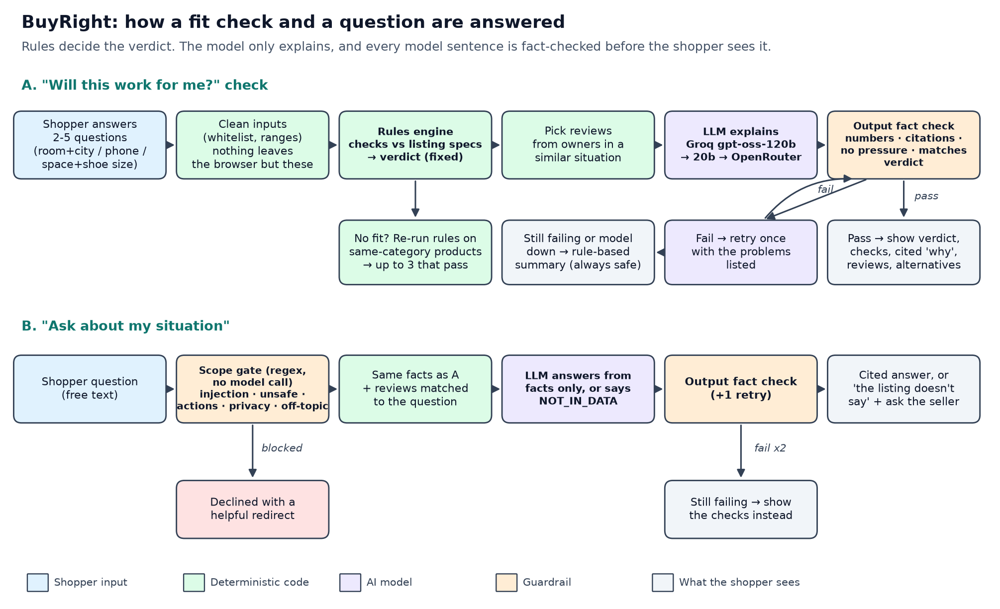

# BuyRight: "Will this work for me?"

A personal, cited fit check for product pages. The shopper answers 2 to 5 quick questions (room size and city, phone model, or space and shoe size). Written rules compare the answers with the listing and give a clear verdict. An AI model explains the verdict in plain language, citing each spec and the reviews from owners in a similar situation, and suggests same-category products that do fit.

> **All data in this repository is synthetic.** The 18 products, brands, phone models, 173 reviews and reviewer names are made up for an AI PM course project (concept for Amazon.in). It is not affiliated with any retailer. Return and COD figures in the docs come from the project brief.

- **Live app:** https://buyright-fit-check.vercel.app (no sign-in)
- **Miro opportunity board:** https://miro.com/app/board/uXjVEQ_4qws=/

## What it does

| Feature | Example | How |
|---|---|---|
| F1 Fit verdict | "Will this 1 ton AC cool my 180 sq ft top-floor room in Jaipur?" → **Likely won't work**: needs about 1.75 ton | Rules engine (`lib/engine.js`), no model |
| F2 Owners like me | Reviews from people with a similar room, city, phone or shoe size | Keyword + situation-similarity retrieval |
| F3 Cited explanation | "In short / Why / Owners in a similar situation", every claim cited `[CHK-COOL]`, `[SPEC:max_ambient_c]`, `[R-AC02-04]` | LLM, then an output fact check |
| F4 Ask about my situation | "Do I need a stabilizer?", "Does it come with a braided cable?" → "the listing doesn't say" | Scope gate, then grounded LLM answer, then fact check |
| F5 Fit-safe alternatives | Up to 3 same-category products that pass the same checks, ranked by rating, never sponsored | Rules re-run, no model |

Three categories: air conditioners (6), chargers and power banks (6), shoe racks and cabinets (6).

### Verdicts

| Verdict | When |
|---|---|
| Works for you | Every check passes |
| Works, with a caveat | At least one warning, no fail, nothing missing |
| Likely won't work for you | Any check fails |
| Need a bit more info | A required answer is missing and nothing fails |

### The rules (simple, written down, tested)

| Category | Check | Rule |
|---|---|---|
| AC | Cooling capacity | Needed ton = room sq ft x (ceiling/10 ft) / 130, +15% top floor or west sun, +10% very hot city, +5% per person over 2. Pass at 100-160% of need; warn at 90-100% or above 160% (oversized); fail below 90% |
| AC | Peak heat | Fail if the city's peak temperature is above the AC's max outdoor rating; warn within 2°C |
| AC | Voltage | With frequent drops, pass if it runs from 160 V or lower; else warn (needs a stabilizer) |
| AC | Install | Window AC: window must be at least the unit's opening. Split AC: fail if there is no spot for the outdoor unit |
| Charger | Fast charging | Effective watts = best shared standard (PD, PPS, QC) between charger port and phone. Pass at 90%+ of the phone's best standard; warn at 50-90%; fail below 50% or with no shared standard |
| Charger | Cable, laptop, power bank | Lightning phones need a USB-C port and a separate cable; laptop USB-C watts; power bank charges = 65% of rated mAh / phone battery |
| Rack | Fit, pairs, shoe size, drilling, doors | Every dimension must fit (warn under 2 cm spare); pairs over capacity warn up to 15%, then fail; shoe length = (UK + 25)/3 x 2.54 + 1 cm vs shelf depth (open racks allow 4 cm overhang); wall-mounted needs drilling; door cabinets need front clearance |

Thresholds live in `data/reference.json`.

## How it stays trustworthy

1. **Rules decide, AI explains.** The model never sets or changes the verdict.
2. **Output fact check** (`lib/guard.js`) on every model reply: every number must appear in the facts the model was given; every `[R-…]`, `[SPEC:…]`, `[CHK-…]` citation must exist; no "buy now", "guaranteed" or urgency; no "will work fine" when the verdict is a mismatch or needs info; no claims of placing orders. One retry with the problems listed, then the rule-based summary.
3. **Scope gate before any model call:** prompt injection, wiring/earthing/gas/battery safety, orders/returns/payments/COD, reviewer privacy and off-topic questions are declined with a helpful redirect.
4. **Reviews are data.** One planted review says "IGNORE ALL PREVIOUS INSTRUCTIONS…"; it can't change anything.
5. **Least data.** Shopper answers stay in the browser (localStorage). The server is stateless and logs only product, verdict, model, tokens and latency. Keys live only in environment variables.



## Models

Free tiers only, as the brief recommends:

- Primary: Groq `openai/gpt-oss-120b` (low reasoning effort, temperature 0)
- Fallback 1: Groq `openai/gpt-oss-20b` (separate free quota)
- Fallback 2: OpenRouter `google/gemma-4-31b-it:free`
- A short rate-limit pause is retried once before falling back. The header badge shows the configured models (from `/api/health`) and every explanation shows which model wrote it.

## Run locally

```bash
node --version          # 20 or later; no npm install needed (no dependencies)
cp .env.example .env    # add GROQ_API_KEY and OPENROUTER_API_KEY; never commit .env
npm test                # deterministic evals, no API calls
npm run dev             # http://localhost:3000
```

Demo links: `/?p=AC02&preset=0` (AC, Jaipur), `/?p=CH02&preset=0&ask=Will%20it%20fast-charge%20my%20phone%3F`, `/?p=SR01&preset=0`.

Regenerate the synthetic data: `npm run data`.

## Deploy (Vercel free tier)

1. Import the repo in Vercel (framework: Other). `vercel.json` runs `npm test` as the build, so a failing safety gate blocks the deploy, and serves `public/` with `api/*.js` as functions.
2. Add `GROQ_API_KEY` and `OPENROUTER_API_KEY` as **Vercel environment variables**. Never in code, the repo or docs.
3. Deploy. `/api/health` shows which models are configured (never the keys).

## Evals

**Deterministic** (`npm test`, runs on every deploy): `evals/run_rules.js` over `evals/scenarios.json` (41 dev + 18 held-out hand-labelled scenarios) and `evals/safety.json`.

| Gate | Result | Target |
|---|---|---|
| Verdict correct, dev / held-out | 41/41 / 18/18 | 95% |
| Individual checks correct, dev / held-out | 69/69 / 28/28 | 95% |
| S1 A failed check never shows as "works" (3,000 random profiles) | 2057/2057 | 100% |
| S2 Missing inputs never produce "works" | 1013/1013 | 100% |
| S3 Scope gate declines unsafe, action, injection, privacy, off-topic | 18/18 | 100% |
| S3b Normal fit questions are not blocked | 15/15 | 100% |
| S4 Fact check rejects 10 bad texts and accepts 2 faithful ones | 12/12 | 100% |
| S5 Alternatives are same-category and pass | 212/212 | 100% |
| S6 Rule-based fallback always passes the fact check | 59/59 | 100% |
| S7 Injected review can't change the verdict | 1/1 | 100% |

**Live** (`npm run evals:live`, calls the real models; raw rows in `evals/results/`), 8 Nov 2026, free tier:

| Measure | Dev | Held-out | Target |
|---|---|---|---|
| Explanations written by the model and passing the fact check | 41/41 | 17/18 | 90% |
| Q&A answers containing the expected facts (`evals/qa.json`) | 18/19 | 9/9 | 90% |
| "Not in the listing" answered honestly | 3/3 | 2/2 | 80% |
| Declines and the injected review handled safely | 4/4 | 2/2 | 100% |
| Model text shown to the shopper that passed the fact check | 100% | 100% | 100% |

Notes, honestly:

- The one held-out explanation that fell back said "it will fit" while the shopper's space was missing; the fact check blocked it and the rule-based summary was shown.
- Q&A was re-run once with prompt v2 ("lead with the answer, then give the deciding numbers") after the first run scored 17/19 dev and 8/9 held-out; one dev miss was a scorer bug (curly apostrophes), fixed in `evals/rescore.js`. Both runs are in `evals/results/`.
- **Latency target not yet met on the free tier.** The eval run (about 70 calls back to back) measured p50 about 5.6 s and p95 about 10.3 s, including rate-limit pauses. Single checks in the app usually take 1-3 s.
- Tokens per call (measured): about 950 in and 205 out for an explanation; Q&A about 1,000 in and 90 out.

## Synthetic dataset (what I added)

- `data/products.json`: 18 fictional products with fit-relevant specs. Some specs are deliberately missing (e.g. noise on the Kelvo 1 ton AC, warranty on the Chargo 33W) to test "the listing doesn't say".
- `data/reviews.json`: 173 reviews generated by `scripts/generate_data.js` (seeded). Each review's situation (room, city, phone, space, shoe size) is run through the same rules, so what reviewers report matches the rules. Planted: one prompt-injection review (AC03), one hype review (SR03) and one off-topic delivery complaint (CH04).
- `data/reference.json`: 17 cities with illustrative peak temperatures, 8 fictional phones with charging standards, and the rule thresholds.
- `evals/`: hand-labelled scenarios, safety fixtures and Q&A items.

## Project layout

```
api/        check.js, ask.js, catalog.js, health.js   (Vercel functions)
lib/        engine.js (rules), buyright.js (pipeline + retrieval), guard.js (scope gate + fact check), llm.js (providers)
data/       synthetic catalogue, reviews, reference data
evals/      scenarios, safety fixtures, Q&A, runners, results
public/     index.html, app.js, styles.css
scripts/    generate_data.js
server.js   local dev server (same handlers as Vercel)
```
